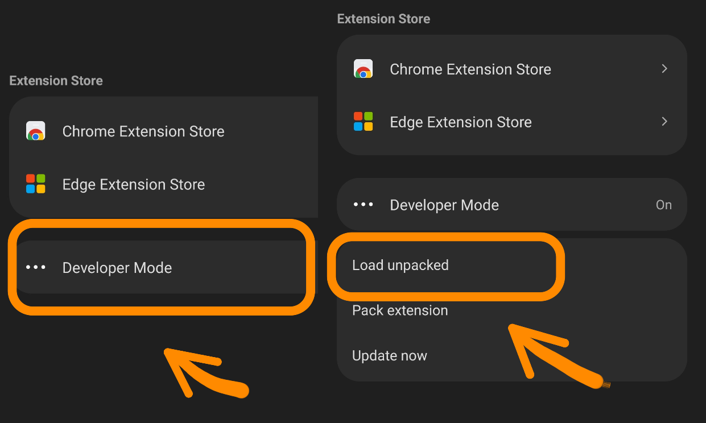
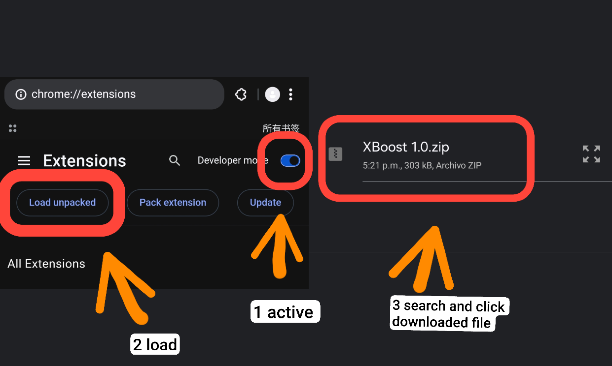

# 🚀 XBoost

A Chrome extension to grow your X (Twitter) network by following users who are likely to follow you back.

---

## 🇬🇧 English

### ✨ Features

- ✅ **Smart auto-follow** — only follows users with a favorable ratio
- ✅ **Suggestion list** — users likely to follow you back
- ✅ **Custom banner** on your timeline
- ✅ **"Thanks for following back" badges** in notifications
- ✅ **Multi-language** (English / Spanish)
- ✅ **Optional auto-follow** with a toggle

### ⬇️ Download

👉 **[Download latest version](../../releases/latest)**

Or go to the [Releases](../../releases) section.

### 📱 Install on Android

Works with Chromium-based browsers that support extensions:
**Kiwi Browser**, **Lemur Browser**, or **Mises Browser**.

📖 **[Full step-by-step guide →](docs/install-android.md)**

Quick steps:
1. Install **Kiwi Browser** or **Lemur Browser** from Play Store
2. Download the ZIP from [Releases](../../releases)
3. Open the browser menu → **Extensions**
4. Enable **Developer mode**
5. Tap **"Load from ZIP"** and select the file
6. Done ✅

| Install browser | Developer mode | Load ZIP |
|:---:|:---:|:---:|
|  |  |  |

### 💻 Install on PC (Chrome / Edge / Brave)

📖 **[Full step-by-step guide →](docs/install-pc.md)**

Quick steps:
1. Download the ZIP from [Releases](../../releases)
2. **Extract** the file (important)
3. Open `chrome://extensions`
4. Enable **Developer mode** (top right)
5. Click **"Load unpacked"**
6. Select the **folder** (not the ZIP)

| Developer mode | Load unpacked | Installed |
|:---:|:---:|:---:|
|  |  |  |

### 🎮 How to use

1. Open [x.com](https://x.com) and log in
2. Click the XBoost icon in the extensions bar
3. Wait for device verification
4. Click **"Connect account"**
5. Select your account on the page that opens
6. Done! You'll see a list of suggested users

📖 **[Detailed usage guide →](docs/usage.md)**

### ⚠️ Important notice

This software **automates actions on X (Twitter)**, which **may violate their Terms of Service**. Use it **at your own risk**.

- 🚫 Do not publish this extension on the Chrome Web Store
- ⚠️ X may suspend accounts that use automation
- 🔒 Read [PRIVACY.md](PRIVACY.md) to know what data is sent
- 📜 Read [DISCLAIMER.md](DISCLAIMER.md) before using it

### 📄 Documentation

- [Install on PC](docs/install-pc.md)
- [Install on Android](docs/install-android.md)
- [Usage guide](docs/usage.md)
- [Privacy Policy](PRIVACY.md)
- [Disclaimer](DISCLAIMER.md)
- [Changelog](CHANGELOG.md)

### 📜 License

**Proprietary — All Rights Reserved.**

This software is provided for **personal, non-commercial use only**.
Modification, redistribution, and monetization are **expressly prohibited**.

See [LICENSE](LICENSE) for full terms.

### ⚖️ DMCA / Copyright

Unauthorized distribution, modification, or monetization of this software
will result in **DMCA takedown notices** under 17 U.S.C. § 512.

---

## 🇪🇸 Español

### ✨ Características

- ✅ **Auto-follow inteligente** — solo sigue a usuarios con ratio favorable
- ✅ **Lista de sugerencias** — usuarios que probablemente te devuelvan el follow
- ✅ **Banner personalizado** en tu timeline
- ✅ **Badges de "gracias por seguir"** en notificaciones
- ✅ **Multi-idioma** (English / Español)
- ✅ **Auto-follow opcional** con un toggle

### ⬇️ Descarga

👉 **[Descargar última versión](../../releases/latest)**

O ve a la sección [Releases](../../releases).

### 📱 Instalación en Android

Funciona con navegadores basados en Chromium que permitan extensiones:
**Kiwi Browser**, **Lemur Browser** o **Mises Browser**.

📖 **[Guía completa paso a paso →](docs/install-android.md)**

Pasos rápidos:
1. Instala **Kiwi Browser** o **Lemur Browser** desde Play Store
2. Descarga el ZIP desde [Releases](../../releases)
3. Abre el menú del navegador → **Extensiones**
4. Activa **Modo desarrollador**
5. Toca **"Cargar desde ZIP"** y selecciona el archivo
6. Listo ✅

| Instalar navegador | Modo desarrollador | Cargar ZIP |
|:---:|:---:|:---:|
|  |  |  |

### 💻 Instalación en PC (Chrome / Edge / Brave)

📖 **[Guía completa paso a paso →](docs/install-pc.md)**

Pasos rápidos:
1. Descarga el ZIP desde [Releases](../../releases)
2. **Descomprime** el archivo (importante)
3. Abre `chrome://extensions`
4. Activa **Modo de desarrollador** (arriba a la derecha)
5. Clic en **"Cargar descomprimida"**
6. Selecciona la **carpeta** (no el ZIP)

| Modo desarrollador | Cargar descomprimida | Instalada |
|:---:|:---:|:---:|
|  |  |  |

### 🎮 Cómo usar

1. Abre [x.com](https://x.com) e inicia sesión
2. Haz clic en el icono de XBoost en la barra de extensiones
3. Espera la verificación del dispositivo
4. Pulsa **"Conectar cuenta"**
5. Selecciona tu cuenta en la página que se abre
6. ¡Listo! Verás una lista de usuarios sugeridos

📖 **[Guía de uso detallada →](docs/usage.md)**

### ⚠️ Aviso importante

Este software **automatiza acciones en X (Twitter)**, lo cual **puede violar sus Términos de Servicio**. Úsalo **bajo tu propio riesgo**.

- 🚫 No publiques esta extensión en la Chrome Web Store
- ⚠️ X puede suspender cuentas que usen automatización
- 🔒 Revisa [PRIVACY.md](PRIVACY.md) para saber qué datos se envían
- 📜 Lee [DISCLAIMER.md](DISCLAIMER.md) antes de usarla

### 📄 Documentación

- [Instalación en PC](docs/install-pc.md)
- [Instalación en Android](docs/install-android.md)
- [Guía de uso](docs/usage.md)
- [Política de privacidad](PRIVACY.md)
- [Aviso legal](DISCLAIMER.md)
- [Changelog](CHANGELOG.md)

### 📜 Licencia

**Propietaria — Todos los derechos reservados.**

Este software se proporciona **únicamente para uso personal y no comercial**.
La modificación, redistribución y monetización están **expresamente prohibidas**.

Consulta [LICENSE](LICENSE) para los términos completos.

### ⚖️ DMCA / Copyright

La distribución, modificación o monetización no autorizada de este software
resultará en **notificaciones DMCA** bajo 17 U.S.C. § 512.

---

## 📬 Contact / Contacto

- **GitHub:** [@CrudeSoftware](https://github.com/CrudeSoftware)
- **Repository:** [github.com/CrudeSoftware/XBoost](https://github.com/CrudeSoftware/XBoost)
