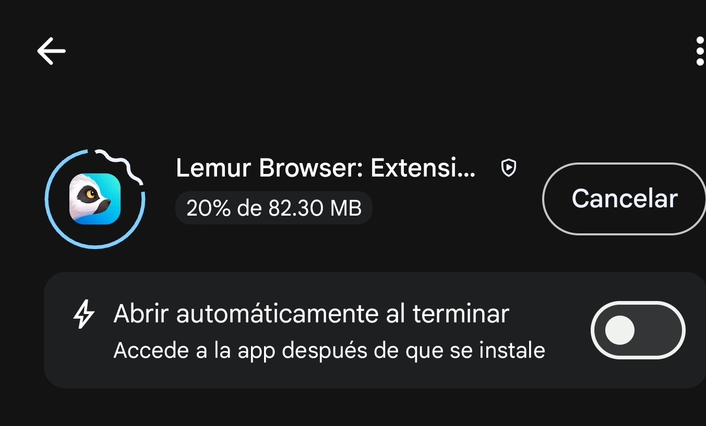
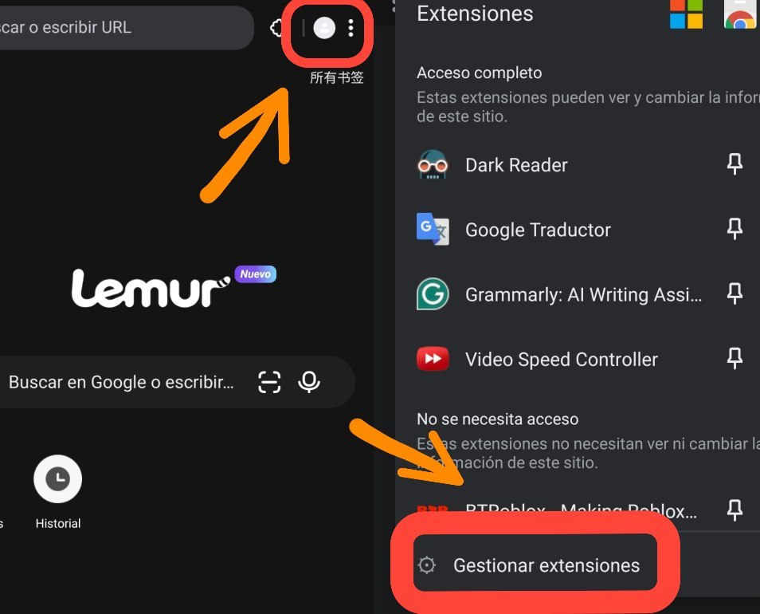
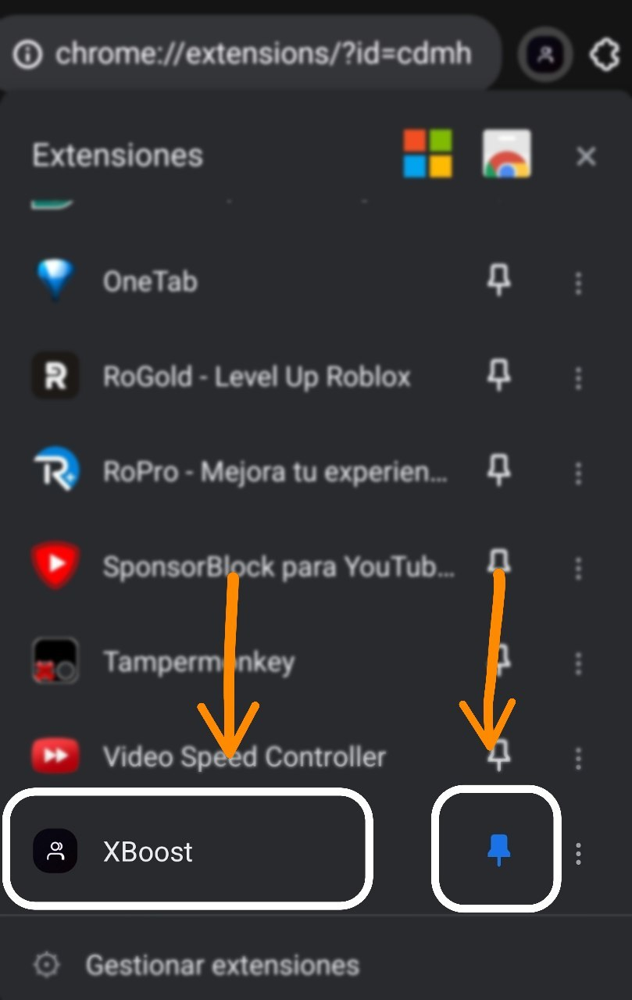

# 📱 Install on Android / Instalación en Android

---

## 🇬🇧 English

### Requirements

- Android 8.0 or higher
- A browser with extension support:
  - ✅ **Kiwi Browser** (recommended)
  - ✅ **Lemur Browser** (modern alternative)
  - ✅ **Mises Browser**

> ❌ Chrome for Android does **not** support extensions.
> ❌ Firefox for Android supports extensions, but **not** Chrome ones.

### Step 1 — Install a compatible browser

Download **Kiwi Browser** or **Lemur Browser** from the Play Store.

### Step 2 — Download the XBoost ZIP

Go to the [Releases](../../releases) section and download `XBoost.zip`.

> 💡 The file will be saved in `Downloads` by default.

### Step 3 — Open the extensions menu

In Kiwi Browser:
1. Tap the menu (⋮) at the top right
2. Select **"Extensions"**

In Lemur Browser:
1. Menu (⋮) → **"Extensions"**

### Step 4 — Enable Developer Mode

Top right you'll see a **"Developer mode"** toggle. Turn it on.

### Step 5 — Load the ZIP

New buttons will appear:
- **"Load unpacked"**
- **"Load from ZIP"** ← this one

Tap **"Load from ZIP"** and select `XBoost.zip`.

### Step 6 — Verify it's active

The extension will appear in the list. Make sure it's **enabled** (blue toggle).

### Step 7 — Use it

1. Open [x.com](https://x.com) and log in
2. Tap the menu → **Extensions** → **XBoost**
3. Wait for device verification
4. Tap **"Connect account"**
5. Authorize your account
6. Start following!

### ❓ Common issues

**"Load from ZIP" button doesn't appear**
- Make sure Developer Mode is enabled
- Some versions only show "Load unpacked": extract the ZIP with ZArchiver and select the folder

**Extension doesn't work on x.com**
- Refresh the page after installing
- Verify x.com is in the allowed sites list

**Kiwi Browser was discontinued**
- Yes, in 2024. It still works, but alternatives are: **Lemur Browser**, **Mises Browser**, or Kiwi forks.

---

## 🇪🇸 Español

### Requisitos

- Android 8.0 o superior
- Un navegador con soporte de extensiones:
  - ✅ **Kiwi Browser** (recomendado)
  - ✅ **Lemur Browser** (alternativa moderna)
  - ✅ **Mises Browser**

> ❌ Chrome para Android **no** soporta extensiones.
> ❌ Firefox para Android soporta extensiones, pero **no** las de Chrome.

### Paso 1 — Instala un navegador compatible

Descarga **Kiwi Browser** o **Lemur Browser** desde Play Store.

### Paso 2 — Descarga el ZIP de XBoost

Ve a la sección [Releases](../../releases) y descarga el archivo `XBoost.zip`.

> 💡 El archivo se guardará en `Descargas` por defecto.

### Paso 3 — Abre el menú de extensiones

En Kiwi Browser:
1. Toca el menú (⋮) arriba a la derecha
2. Selecciona **"Extensiones"**

En Lemur Browser:
1. Menú (⋮) → **"Extensiones"**

### Paso 4 — Activa el Modo Desarrollador

Arriba a la derecha verás un toggle **"Modo desarrollador"**. Actívalo.

### Paso 5 — Carga el ZIP

Aparecerán botones nuevos:
- **"Cargar descomprimida"**
- **"Cargar desde ZIP"** ← este

Toca **"Cargar desde ZIP"** y selecciona `XBoost.zip`.

### Paso 6 — Verifica que esté activa

La extensión aparecerá en la lista. Asegúrate de que esté **activada** (toggle azul).

### Paso 7 — Úsala

1. Abre [x.com](https://x.com) e inicia sesión
2. Toca el menú → **Extensiones** → **XBoost**
3. Espera la verificación del dispositivo
4. Pulsa **"Conectar cuenta"**
5. Autoriza tu cuenta
6. ¡A seguir!

### ❓ Problemas frecuentes

**No aparece el botón "Cargar desde ZIP"**
- Asegúrate de haber activado el Modo Desarrollador
- En algunas versiones solo hay "Cargar descomprimida": descomprime el ZIP con ZArchiver y selecciona la carpeta

**La extensión no funciona en x.com**
- Refresca la página después de instalarla
- Verifica que x.com esté en la lista de sitios permitidos

**Kiwi Browser fue descontinuado**
- Sí, en 2024. Sigue funcionando, pero alternativas: **Lemur Browser**, **Mises Browser** o forks de Kiwi.
